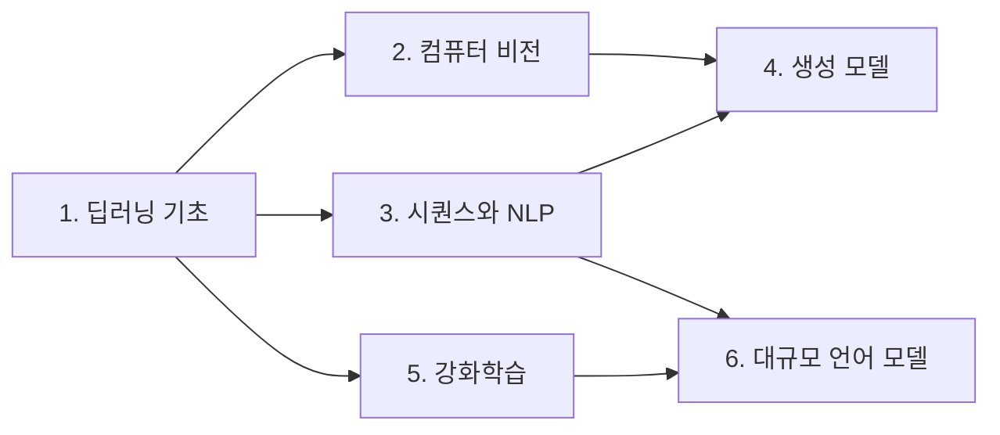

# 📚 AI 입문자를 위한 논문 로드맵

[](https://github.com/regx64/paper/actions/workflows/link-check.yml)

AI를 처음 공부하는 사람이 **어떤 순서로, 어떤 논문을, 어떻게 읽으면 좋은지** 정리한 저장소입니다.
논문마다 한국어 요약 노트를 달아, 원문을 읽기 전에 큰 그림을 먼저 잡을 수 있게 하는 것이 목표입니다.

- 논문을 많이 모으기보다 **입문자가 꼭 읽을 만한 35편 정도**만 골랐습니다.
- 앞 단계의 논문이 뒤 단계의 사전 지식이 되도록 **읽는 순서**를 정했습니다.
- PDF는 올리지 않고 arXiv 등 **공식 링크**만 연결합니다.

## 시작하기

1. 논문이 처음이라면 [**논문 읽는 법**](HOW_TO_READ.md)을 먼저 읽어 보세요.
2. 아래 로드맵에서 ⭐ 논문부터 순서대로 읽고, 각 논문의 **노트**로 큰 그림을 먼저 잡으세요.
3. 모르는 용어는 [**용어집**](GLOSSARY.md)에서 찾아보세요.

## 이런 분께 추천합니다

- 파이썬과 기초 수학(미분, 행렬, 확률)을 알고 있다
- 머신러닝/딥러닝 강의를 한두 개 들어봤지만, 논문은 처음이다
- "트랜스포머", "디퓨전", "RLHF" 같은 말이 어디서 나왔는지 궁금하다

## 로드맵



처음이라면 **1단계 → 3단계 → 6단계** 순서로 ⭐ 논문만 먼저 읽고, 관심 있는 분야(비전·생성·강화학습)로 넓혀 가는 것을 추천합니다.

| 단계 | 주제 | 핵심 질문 | 논문 수 |
|---|---|---|---|
| [1](papers/01-foundations/) | 딥러닝 기초 | 신경망은 어떻게 학습하나? | 6 |
| [2](papers/02-computer-vision/) | 컴퓨터 비전 | 모델은 이미지를 어떻게 이해하나? | 6 |
| [3](papers/03-sequence-and-nlp/) | 시퀀스와 NLP | 모델은 언어를 어떻게 다루나? | 8 |
| [4](papers/04-generative-models/) | 생성 모델 | 모델은 새로운 것을 어떻게 만드나? | 5 |
| [5](papers/05-reinforcement-learning/) | 강화학습 | 모델은 시행착오로 어떻게 배우나? | 3 |
| [6](papers/06-large-language-models/) | 대규모 언어 모델 | ChatGPT는 어떻게 만들어졌나? | 7 |

## ⭐ 꼭 읽을 논문 13편

| # | 논문 | 연도 | 난이도 | 단계 | 노트 |
|---|---|---|---|---|---|
| 1 | [Deep Learning](https://www.nature.com/articles/nature14539) | 2015 | 🟢 | 1 | [노트](papers/01-foundations/2015-deep-learning.md) |
| 2 | [Dropout](https://jmlr.org/papers/v15/srivastava14a.html) | 2014 | 🟢 | 1 | [노트](papers/01-foundations/2014-dropout.md) |
| 3 | [Adam](https://arxiv.org/abs/1412.6980) | 2014 | 🟡 | 1 | [노트](papers/01-foundations/2014-adam.md) |
| 4 | [AlexNet](https://proceedings.neurips.cc/paper/2012/hash/c399862d3b9d6b76c8436e924a68c45b-Abstract.html) | 2012 | 🟢 | 2 | [노트](papers/02-computer-vision/2012-alexnet.md) |
| 5 | [ResNet](https://arxiv.org/abs/1512.03385) | 2015 | 🟡 | 2 | [노트](papers/02-computer-vision/2015-resnet.md) |
| 6 | [word2vec](https://arxiv.org/abs/1301.3781) | 2013 | 🟢 | 3 | [노트](papers/03-sequence-and-nlp/2013-word2vec.md) |
| 7 | [Attention Is All You Need (Transformer)](https://arxiv.org/abs/1706.03762) | 2017 | 🟡 | 3 | [노트](papers/03-sequence-and-nlp/2017-attention-is-all-you-need.md) |
| 8 | [BERT](https://arxiv.org/abs/1810.04805) | 2018 | 🟡 | 3 | [노트](papers/03-sequence-and-nlp/2018-bert.md) |
| 9 | [GAN](https://arxiv.org/abs/1406.2661) | 2014 | 🟢 | 4 | [노트](papers/04-generative-models/2014-gan.md) |
| 10 | [DDPM](https://arxiv.org/abs/2006.11239) | 2020 | 🔴 | 4 | [노트](papers/04-generative-models/2020-ddpm.md) |
| 11 | [DQN](https://arxiv.org/abs/1312.5602) | 2013 | 🟡 | 5 | [노트](papers/05-reinforcement-learning/2013-dqn.md) |
| 12 | [LoRA](https://arxiv.org/abs/2106.09685) | 2021 | 🟡 | 6 | [노트](papers/06-large-language-models/2021-lora.md) |
| 13 | [InstructGPT](https://arxiv.org/abs/2203.02155) | 2022 | 🟡 | 6 | [노트](papers/06-large-language-models/2022-instructgpt.md) |

난이도: 🟢 쉬움 · 🟡 보통 · 🔴 어려움

전체 35편의 목록과 노트는 각 단계 폴더의 README에 있습니다.

## 저장소 구조

```
├── README.md            # 지금 보고 있는 문서
├── PLAN.md              # 저장소 계획서
├── HOW_TO_READ.md       # 논문 읽는 법
├── GLOSSARY.md          # 용어집 (한국어/영어)
├── CONTRIBUTING.md      # 논문 추가·노트 작성 규칙
├── lychee.toml          # 링크 점검 설정
├── templates/
│   └── paper-note.md    # 논문 노트 템플릿
└── papers/
    ├── 01-foundations/          # 단계별 README + 논문 노트
    ├── 02-computer-vision/
    ├── 03-sequence-and-nlp/
    ├── 04-generative-models/
    ├── 05-reinforcement-learning/
    └── 06-large-language-models/
```

## 진행 상황

- [x] Phase 1. 뼈대 — 폴더 구조, README, 템플릿, 기여 규칙
- [x] Phase 2. ⭐ 필수 논문 13편 노트
- [x] Phase 3. 나머지 논문 22편 노트, 논문 읽는 법, 용어집
- [x] Phase 4. 링크 자동 점검 (GitHub Actions, 매주 월요일 + 문서 변경 시)

## 기여하기

논문 추천, 노트 작성, 오타 수정 모두 환영합니다. [CONTRIBUTING.md](CONTRIBUTING.md)를 참고해 주세요.
